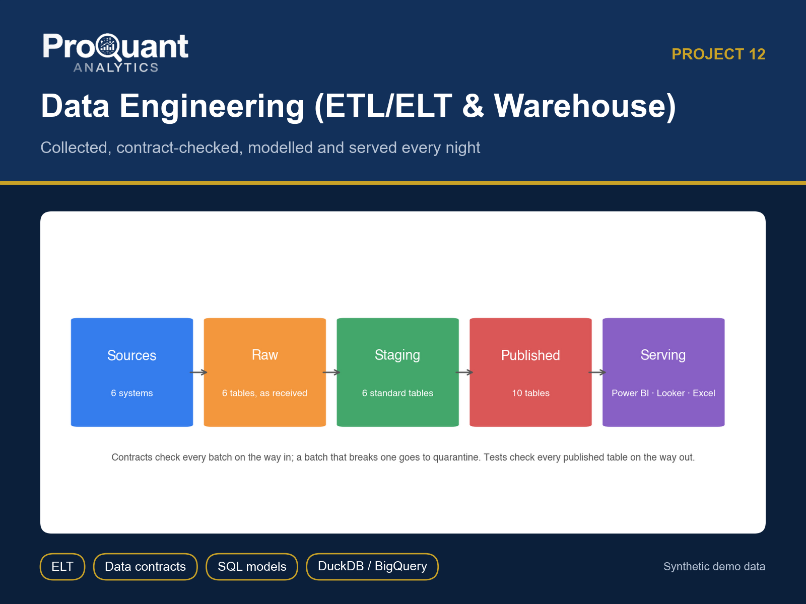
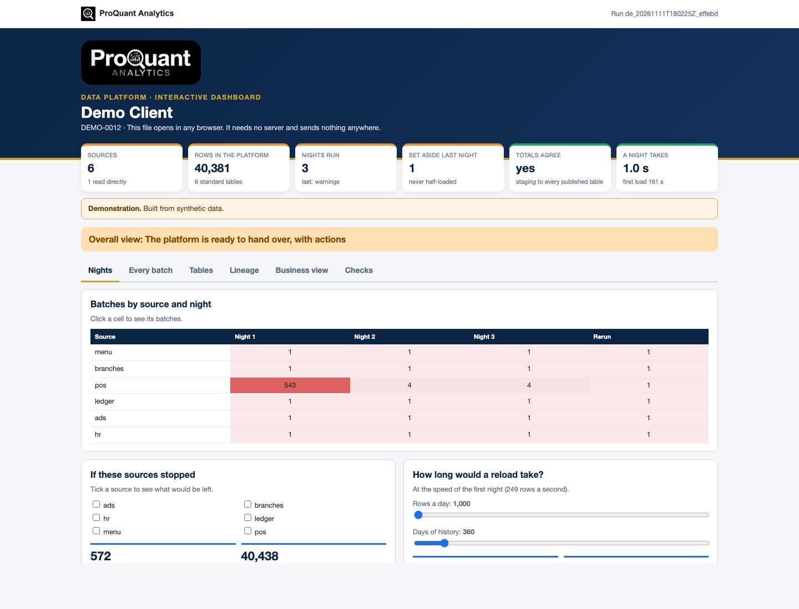
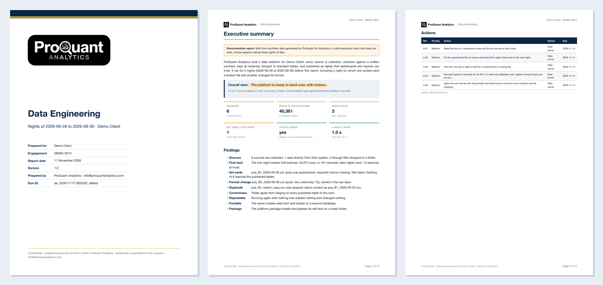
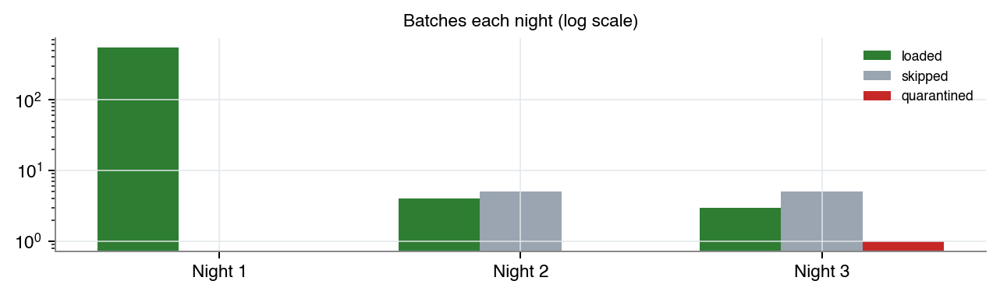
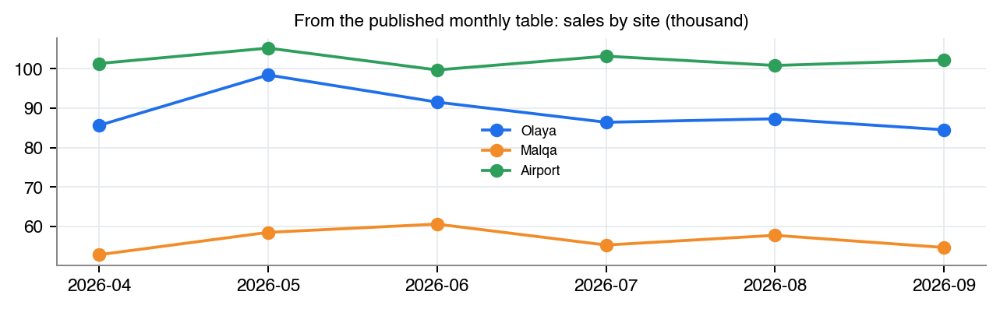
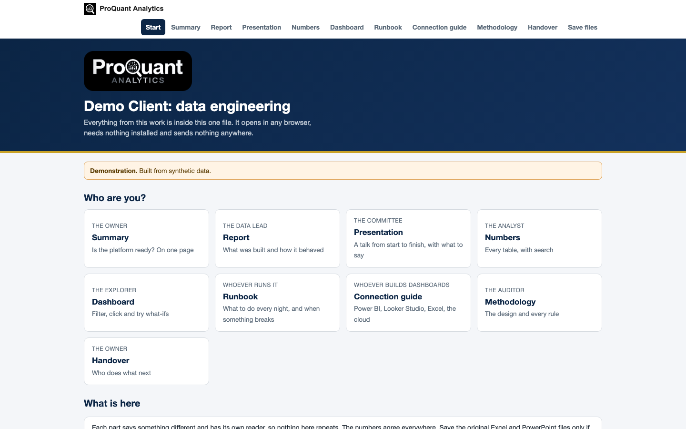

# Data Engineering (ETL/ELT & Warehouse)

**One trusted foundation for a business's data: collected, contract-checked, modelled and served every night.**

  

> **Showcase repository.** It shows the method and the actual files a client receives, built on **synthetic demo data** (a fictional *Demo Client*). The numbers below are illustrative, not client results. The production code is proprietary and is not published here.

## Contents

- [Business problem](#business-problem)
- [Approach](#approach)
- [Results (demo)](#results-demo)
- [Deliverables](#deliverables)
- [Gallery](#gallery)
- [Tech stack](#tech-stack)
- [How to view it](#how-to-view-it)
- [How an engagement works](#how-an-engagement-works)

## Business problem

A file arrives late, broken or twice; a system changes its export; nobody can say where a number came from. Dashboards are built on spreadsheets that only one person understands.

**Typical clients:** Any company whose reports start with someone exporting files and fixing them by hand.

## Approach

- Sources: drop folders, read-only database queries, APIs, Google Sheets, cloud storage or SFTP
- Incremental loads: files once each by content hash, full exports on change, rows after a watermark
- Data contracts: a batch that breaks its contract is quarantined whole, with its reason
- Raw -> Staging -> Published layers; plain SQL models that run on DuckDB, SQLite, PostgreSQL and BigQuery
- Tests: unique keys, required values, references, totals carried to the cent, freshness
- Nightly CSV / Parquet serving for Power BI, Looker Studio and Excel; schedules and a runbook

## Results (demo)

**Overall opinion on the demo data:** Overall view: The platform is ready to hand over, with actions

| Measure | Value | Context |
|---|---:|---|
| Sources | **6** | 1 read directly |
| Rows in the platform | **40,381** | 6 standard tables |
| Nights run | **3** | last: warnings |
| Set aside last night | **1** | never half-loaded |
| Totals agree | **yes** | staging to every published table |
| A night takes | **1.0 s** | first load 161 s |

<em>The interactive dashboard (one HTML file: Nights, Every batch, Tables, Lineage, Business view, Checks). <a href="https://abduwars.github.io/proquant-12-data-engineering/sample-delivery/10_DemoClient_DataEngineering_Dashboard_v1.0_20261111.html">Open it live</a>.</em>

## Deliverables

Everything opens from **one file**, *Start here* (no. 1), in any browser: pick your role, read each document, watch the presentation, search the tables and use the dashboard. Each document has one reader and one job, and the numbers agree across all of them. PowerPoint and Excel files open in the browser through Microsoft's free online viewer; *download* gives the original file.

| # | File | Format | What it is |
|---|---|---|---|
| 1 | [Start here](https://abduwars.github.io/proquant-12-data-engineering/sample-delivery/00_START_HERE_DemoClient.html) | HTML (opens in any browser) | **One file that holds it all**: every document, the presentation, the tables and the dashboard |
| 2 | [Report](sample-delivery/01_DemoClient_DataEngineering_Report_v1.0_20261111.pdf) | PDF | *The data lead*: What was built and how it behaved over the nights (~15 pages) |
| 3 | [Summary](sample-delivery/02_DemoClient_DataEngineering_Summary_v1.0_20261111.pdf) | PDF | *The owner*: One page: the decision, with no charts |
| 4 | [Presentation](https://view.officeapps.live.com/op/view.aspx?src=https%3A%2F%2Fabduwars.github.io%2Fproquant-12-data-engineering%2Fsample-delivery%2F03_DemoClient_DataEngineering_Presentation_v1.0_20261111.pptx) | PowerPoint · [download](https://raw.githubusercontent.com/AbduWars/proquant-12-data-engineering/main/sample-delivery/03_DemoClient_DataEngineering_Presentation_v1.0_20261111.pptx) | *The management team*: **A full talk**: 12 slides with editable charts and speaker notes |
| 5 | [Results Workbook](https://view.officeapps.live.com/op/view.aspx?src=https%3A%2F%2Fabduwars.github.io%2Fproquant-12-data-engineering%2Fsample-delivery%2F04_DemoClient_DataEngineering_ResultsWorkbook_v1.0_20261111.xlsx) | Excel · [download](https://raw.githubusercontent.com/AbduWars/proquant-12-data-engineering/main/sample-delivery/04_DemoClient_DataEngineering_ResultsWorkbook_v1.0_20261111.xlsx) | *The analyst*: **The working file**: a Control panel by night, every batch, the data dictionary and the lineage |
| 6 | [Methodology](sample-delivery/05_DemoClient_DataEngineering_Methodology_v1.0_20261111.pdf) | PDF | *The auditor*: The design and every rule. No results |
| 7 | [Handover Note](sample-delivery/06_DemoClient_DataEngineering_HandoverNote_v1.0_20261111.pdf) | PDF | *The owner*: Who does what next, which file is for whom |
| 8 | [Runbook](sample-delivery/08_DemoClient_DataEngineering_Runbook_v1.0_20261111.pdf) | PDF | *Whoever runs it*: Every morning, and what to do when something breaks |
| 9 | [Connection Guide](sample-delivery/09_DemoClient_DataEngineering_ConnectionGuide_v1.0_20261111.pdf) | PDF | *Whoever builds dashboards*: Power BI, Looker Studio, Excel, and the company's own cloud |
| 10 | [Dashboard](https://abduwars.github.io/proquant-12-data-engineering/sample-delivery/10_DemoClient_DataEngineering_Dashboard_v1.0_20261111.html) | HTML (opens in any browser) | *Whoever explores*: The nights, every batch, the tables, the lineage and the business view |

**Delivered to clients only, not in this showcase:** the platform package (engine, models, schedules, database scripts).

Also delivered: data-quality reports and long-format CSV / Parquet exports for Power BI or Looker Studio.

<em>The first pages of the PDF report.</em>

## Gallery

<table><tr>
<td width="50%"></td>
<td width="50%"></td>
</tr></table>

<em>The start page: one file, one click, nothing to install.</em>

## Tech stack

Python · pandas · NumPy · matplotlib · Jinja2 + WeasyPrint (PDF) · openpyxl (Excel) · python-pptx (PowerPoint) · pydantic · pytest · SQL · DuckDB · SQLite · PostgreSQL · BigQuery · SQLAlchemy · Parquet (pyarrow)

Every run is reproducible and audited: data fingerprints, configuration and code version are recorded, data-quality checks run before any calculation, and an automated test suite checks every deliverable (including opening the decks and workbooks in Microsoft Office).

## How to view it

1. **In the browser (nothing to install):** open the [live start page](https://abduwars.github.io/proquant-12-data-engineering/sample-delivery/00_START_HERE_DemoClient.html) or the [dashboard](https://abduwars.github.io/proquant-12-data-engineering/sample-delivery/10_DemoClient_DataEngineering_Dashboard_v1.0_20261111.html).
2. **Download:** click any PDF, Excel or PowerPoint file in the table above, or clone the repository: `git clone https://github.com/AbduWars/proquant-12-data-engineering.git`.
3. **On your own data:** this is delivered as a fixed-scope engagement. Write to [info@proquantanalytics.com](mailto:info@proquantanalytics.com).

## How an engagement works

| Step | What happens |
|---|---|
| 1. Discovery call | Your question, your data and the decision the work must support |
| 2. Scope and NDA | Fixed scope, timeline and thresholds agreed **before** any result is seen |
| 3. Data request | A precise list of files or read-only access; personal data pseudonymised |
| 4. Build and interim update | First results, open questions and data issues, early |
| 5. Delivery | The full package above, on your data, with a walk-through |
| 6. Handover | Methodology, runbook where relevant, and optional monthly refresh |

---

<b>ProQuant Analytics</b> · Quant & risk analytics, business analytics and data engineering Rotterdam, NL · remote-first <a href="https://www.proquant-analytics.com">www.proquant-analytics.com</a> · <a href="mailto:info@proquantanalytics.com">info@proquantanalytics.com</a> · <a href="https://github.com/AbduWars">All 12 projects</a>

© 2026 ProQuant Analytics. Sample outputs on synthetic data, shown for demonstration. All rights reserved.

